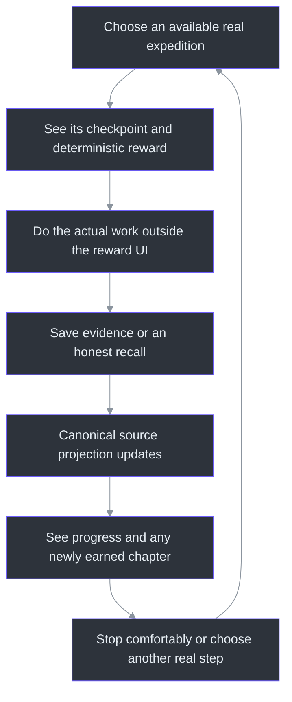
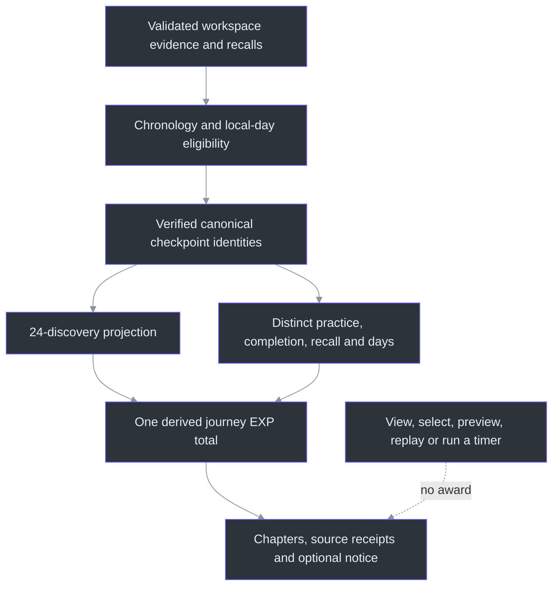

# Atlas progression: from badge cabinet to field expedition

Research and design basis, 2026-11-21. Scope: Discovery Atlas only.

**Decision:** keep the original Wayfinder, its seven real 3D environments and
the 24-discovery collection, but connect the journey to ordinary, distinct
checkpoint work. Put a concrete expedition beside the character, show what the
next reward changes, and acknowledge useful work between collectible unlocks.
The collection still opens on **Discovered**.

This is a researched design hypothesis, not proof that the interface will make
someone study, recover motivation or acquire a skill. The desired outcome is
wanting to return to meaningful work, not being unable to stop using a website.
Numbers below are deliberately chosen product rules, not values established by
psychology experiments.

[Design history](DISCOVERY-DESIGN.md) · [User guide](GUIDE.md) ·
[Implementation workstream](../TODO/25_ATLAS_PROGRESSION_REDESIGN.todo)

## 1. What was investigated, and what was actually read

The six main cases are **Hades, Stardew Valley, Slay the Spire, Factorio,
Celeste and Vampire Survivors**. They cover persistent narrative, ownership,
meaningful route choice, action-triggered progression, adjustable challenge
and visible transformation. These are deliberately different mechanisms, not
six examples of putting a bigger number over the same button.

Evidence labels used throughout:

| Label | Meaning |
|---|---|
| Developer account | A developer's published explanation or attributed interview answer. Evidence of intent, not an experiment proving an effect. |
| Documented mechanic | An official description of what a game offers. Marketing descriptions do not establish why individual players return. |
| Interpretation | This investigation's explanation or proposed transfer into CareerOS. It must not be presented as the developer's claim. |
| Research result | A finding with its original task/population and access scope retained. |
| Product decision | An explicit local choice to implement and evaluate, not an empirically optimal setting. |

Full relevant text was read from the official Hades FAQ, Stardew Valley site,
Stardew developer interview, both developer-authored Steam descriptions, Wube's
Factorio article and the Celeste interview. The relevant Kasavin reporting and
Galante interview bodies were read too; the latter required reading its HTML
because simplified extraction returned an almost empty page. No game video
was watched and no commercial artwork was copied.

The GDC source is **only its public session description**, not the talk or
slides. Two psychology **complete public abstracts** were read from university
records. The Sailer experiment and Sailer/Homner meta-analysis are limited to
indexed source excerpts and bibliographic verification, not reviewed full
papers. Their access failures are retained in section 12. This is a focused
comparative investigation, not a systematic literature review.

## 2. Why the previous loop could feel unrewarding

This diagnosis concerns implementation, not a claim about anyone's psychology.
The inspected baseline is
`e52a16f71c5231b8af1bdfeb83b1ba4544b10d60`, plus the already-qualified local
Discovered-default follow-up.

1. **Structure:** `getWayfinderProgress` used discovered count alone. Seven
   levels were reached at 0, 1, 3, 6, 10, 16 and 24 discoveries; EXP was simply
   that count multiplied by 100. More meaningful records could leave this
   number unchanged. See `src/discovery/model.ts`, the original
   `wayfinderStages` and `getWayfinderProgress`.
2. **Data flow:** evidence and recall already had reliable identities,
   timestamps and source links. `getDiscoverySnapshot` already deduplicated
   verified roadmap lineage. There was no need for a second reward database,
   timer, online account or pretend completion. See `model.ts`,
   `getDiscoverySnapshot`, and `src/domain/catalog.ts`, `checkpointIdentity`.
3. **Integration:** `DiscoveryNotice` announced only newly earned discovery
   IDs. Finishing another checkpoint after a catalogue threshold could produce
   the ordinary save message but no Atlas acknowledgement. See
   `src/discovery/DiscoveryNotice.tsx` and the evidence-save path in `src/App.tsx`.
4. **Presentation:** the collection had a large overview, four families,
   filters and cards, while the actual next checkpoint lived near the bottom.
   The next character reward's artwork was inaccessible until earned. The
   interface explained ownership more clearly than anticipation. See
   `src/discovery/DiscoveryPage.tsx` and `src/discovery/Wayfinder.tsx`.
5. **Synthesis:** the missing connection was
   **specific real action -> understandable progress -> meaningful visible
   change -> a next destination**. Adding another catalogue would preserve the
   same gap with more things to count.

The existing implementation also contains important strengths: real
provenance, unfinished practice, no punitive gaps, explicit criteria and a
bounded renderer. Those are constraints to preserve, not obstacles to remove.

## 3. Case study: Hades -- a return should still mean something

**Sources:** Supergiant's official FAQ [G1], and Greg Kasavin's attributed
LudoNarraCon remarks as reported by GamesHub [G2].

**Documented mechanic.** Supergiant describes repeated runs with different
builds, permanent progression, extensive character interactions and a story
that can be engaged with lightly or deeply. Its FAQ explicitly describes a
range of difficulty modifiers, including God Mode. The game is not dependent
on one exact challenge level being right for every player.

**Developer account.** Kasavin describes aligning the narrative with repeated
attempts and making characters acknowledge changes in player behaviour. The
interesting point is not merely that the player receives a resource. The world
notices what happened, so another return can add context rather than only
replay an identical introduction.

**Interpretation.** Different time horizons overlap: the immediate encounter,
the current escape attempt and a persistent relationship/story. A run need
not achieve its largest objective to contribute to the larger experience.
That is a plausible explanation for the loop's coherence, not an isolated
causal finding about Hades players.

**Transfer.** An unfinished but genuine checkpoint attempt should leave a
trace in the journey. Returning after a break should find earlier work intact.
A reward notice should identify what changed, and a chapter should have an
actual scene, object and short piece of fiction, not just a generic rank label.

**Do not transfer.** CareerOS should not demand repeated failures, randomized
builds or more sessions merely to drip-feed narrative. It should not fabricate
an NPC claiming to know how hard someone worked. Its fiction can acknowledge
a saved artifact, not infer feelings, effort, mastery or a personal history.
Unlike a roguelike, ordinary learning must not be reset to manufacture a run.

**Design consequence.** First practice receives credit separately from
criteria-confirmed completion. Existing records reconstruct the journey on
arrival, without a ceremony that must be watched or a reward that must be
claimed before leaving.

## 4. Case study: Stardew Valley -- ownership and several valid ways forward

**Sources:** the official game description [G3] and Eric Barone's Road to the
IGF interview [G4].

**Documented mechanic.** The official description puts transformation and
choice first: an overgrown plot becomes a farm, with farming, animals,
fishing, crafting, caves, relationships and extensive customization. These
are different activities and visible changes to an inhabited place, not only
different labels for identical points.

**Developer account.** Barone describes starting from the Harvest Moon
formula and expanding it to recapture a particular feeling. His interview
also stresses genuine ideas rather than copying trends. That supports an
important methodological limit: a list of popular features does not recreate
another game's appeal.

**Interpretation.** A self-shaped place can make progress legible without
requiring a leaderboard. Different activities give a player somewhere useful
to turn when one task is unattractive. Ownership is strengthened by choosing
what matters, rather than always obeying a system's newest demand.

**Transfer.** Let the learner choose an existing available mission as an
expedition. Show a short trail through its actual checkpoints. Keep the
character's earned equipment and earlier environments available to revisit.
Use original place-based fiction to make the journey recognizable.

**Do not transfer.** Stardew also has clocks, seasons and opportunity costs;
it would be inaccurate to describe it as entirely pressure-free. CareerOS
does not need missed seasons, crop loss, simulated obligations or a second
management game. Selecting an expedition must not secretly change mission
focus, activate a planned curriculum or generate work.

**Design consequence.** Expedition selection is view state. The saved
mission, blocker and checkpoint remain authoritative. There is one selected
route, not a wall of mandatory daily quests. A later return keeps the same
source records rather than announcing that something has withered.

## 5. Case study: Slay the Spire -- a choice needs understandable consequences

**Sources:** Mega Crit's official game description [G5] and Anthony
Giovannetti's GDC session description [G6].

**Documented mechanic.** Mega Crit describes choosing cards that work
together, choosing riskier or safer paths and discovering relics whose
interactions affect the deck. A route is more than decorative geography:
choices relate to how the current run is being built.

**Developer account, limited access.** The GDC description says the team
used metrics and community feedback to balance the game while preserving
feel and difficulty. It does **not** by itself disclose particular card
statistics, a tested ideal reward cadence or an optimal progression curve.
Those are not claimed here.

**Interpretation.** Agency comes from perceiving why one path suits the
current situation. If every choice hides its consequence, choice can become
guessing; if one path is obviously dominant, the alternatives are cosmetic.
Learning goals already differ in subject matter and current difficulty, so
CareerOS does not need artificial danger to make them distinct.

**Transfer.** Make the actual current checkpoint, its position in a route,
the first-practice award and the completion award visible together. Allow a
different available expedition to be inspected without rewriting focus.
Show the next chapter's requirement and reward before the learner commits
to another substantial work session.

**Do not transfer.** No random card draft for deciding what someone must
learn, no loss of real records at the end of a run, and no gambling for a
rare reward. The GDC use of metrics does not authorize adding telemetry to
a private local-first workspace. Owner feedback and fictional qualification
are the evidence available here.

**Design consequence.** Choosing a mission and previewing a reward are
reversible, non-rewarded views. Real completion remains in the normal
evidence/criteria form, never a one-click quest-claim shortcut.

## 6. Case study: Factorio -- progression should follow doing the thing

**Source:** Wube's Friday Facts #376, particularly its trigger-technology
and early-game sections [G7].

**Developer account.** The article describes a mismatch: players could
research processing for resources they had never encountered, accumulating
recipes ahead of a factory able to use them. Its proposed trigger
technologies instead respond to actions such as mining an entity, crafting
an item or launching a particular payload.

It also explains rejecting temporary systems that created clutter without
remaining useful. In the quality discussion, the author explicitly cautions
that saying an upgrade is optional is not enough if optimization makes its
acquisition feel necessary. The stated principle is that the best strategy
should be enjoyable.

**Interpretation.** The strongest transfer is semantic proximity: a relevant
action produces a relevant change. The article is a developer's design
reasoning, not a study proving that event triggers improve learning.

**Transfer.** Read the evidence and recall events that CareerOS already
validates. First evidence on a distinct checkpoint, its first confirmed
completion and its first honest recall can each contribute. A new page
view, long timer or extra duplicate note is not an equivalent accomplishment.
Reusing canonical checkpoint identity also prevents an apparent new reward
when a verified append merely renames the surrounding roadmap edition.

**Do not transfer.** Functional learning material must not become
technology-locked behind fictional EXP. Learners can read ahead. Do not
introduce temporary crafting materials, conversion shops or a parallel
reward ledger merely to get back to the real curriculum.

**Design consequence.** The economy is a deterministic projection, not a
spendable economy. Its optimal input is useful distinct work, not clicking
the Atlas. A details panel exposes the calculation and supporting records.

## 7. Case study: Celeste -- challenge and support are not opposites

**Source:** Patrick Klepek's direct email interview with the developer,
published by Waypoint/VICE in 2018 [G8]. The article uses the developer's
former name; this document uses Maddy Thorson.

**Developer account.** The interview explicitly connects strawberries,
B-sides and Assist Mode with helping different players find an appropriate
challenge. Assist Mode can change movement speed, stamina, dashes and
survivability. Thorson describes moving away from a judgmental name and
accepting that player empowerment can require letting go of a tightly
tuned default experience.

**Interpretation.** Optional challenge can communicate confidence in the
player without turning difficulty into a moral test. A supportive return
path makes experimenting less costly. The source does not establish that
easy settings or optional collectibles motivate every individual.

**Transfer.** Practice should count without pretending a checkpoint is
finished. An honest Needs review recall should receive the same first-
attempt participation award as a confident one; actual retention status
continues to show the honest outcome. Reduced motion should preserve
rewards and deliberate camera controls. A skipped ceremony is not a
forfeited accomplishment.

**Do not transfer.** Do not lower source-defined checkpoint criteria to
speed up a fantasy level. Do not label ordinary participation as failure
or require an independent recall claim to receive the basic revisit
award. Extra achievement challenges remain optional and separate from
tools needed to study.

**Design consequence.** There is no penalty for gaps or a difficult recall,
no expiring quest and no forced animation. Narrative/reward presentation
can be playful while the actual evidence form remains explicit and sober.

## 8. Case study: Vampire Survivors -- make the change perceptible

**Sources:** Luca Galante's direct Barclays interview [G9] and poncle's
official game description and starting tips [G10].

**Developer account.** Galante describes a simple control scheme with
spells that become larger, faster or emit more projectiles. His account
emphasizes an organically developed game and the appeal of visible
upgrades. It does not establish an ideal number of seconds between
rewards, a neuroscientific explanation or a formula for addiction.

**Documented mechanic.** Poncle describes choices that can snowball,
between-run upgrades and free refunds to try different upgrade paths.
The official starting tips even say that collected items do not disappear
while the player takes time to reach them.

**Interpretation.** A change that is immediately perceivable is easier to
connect to an action than an invisible counter. Its presentation is part
of the result: an upgrade is not merely a line in a statistics table.
That is an interface hypothesis, not proof of psychological dependence.

**Transfer.** Preserve genuinely different scenery and cumulative gear.
Show the exact next form, relic and place through a deliberately requested
blueprint preview. On a threshold crossing, explain the reward and make
it available immediately in the saved-work-derived journey.

**Do not transfer.** Galante's gambling-industry background is not a reason
to add slot-machine schedules, random chests, near-miss effects or
sensory bombardment. There is no autoplay sound, idle particle loop,
flashing jackpot or repeated claim button. A fictional artifact should
not look like evidence that the learner's real abilities multiplied.

**Design consequence.** The next reward becomes concrete, but explicitly
unearned. Viewing its 3D scene changes neither actual level nor storage.
The same small event-driven viewer is reused rather than running a second
animated scene beside it.

## 9. Psychology: what supports the direction, and what pushes back

### Autonomy and competence are not synonymous with a score

Ryan, Rigby and Przybylski [P1] report four studies applying self-
determination theory to games. The complete abstract associates perceived
in-game autonomy and competence with enjoyment and preferences; its
multiplayer survey relates autonomy, competence and relatedness to
enjoyment and future play. These associations do not demonstrate that
an EXP bar causes sustained study, nor that an avatar supplies an actual
social relationship.

**Application:** provide understandable feedback and genuine control over
the next task. Avoid a system that says the learner chose freely while
punishing any choice other than its prescribed daily task.

### Points can increase output without increasing intrinsic motivation

Mekler and colleagues [P2] examined points, levels and leaderboards in an
online image-annotation experiment. Their complete institutional abstract
reports higher tag quantity, without significant effects on competence or
intrinsic motivation versus the control. That is a particularly important
counterexample to promising that more badges will make meaningful work
intrinsically attractive.

**Application:** the first job is to make the task and payoff coherent.
EXP supplies legible feedback; it is not the reason the curriculum matters.
Do not optimize note count or infer learning from time spent in the app.

### Do not flatten mixed research into one slogan

The indexed Sailer experiment abstract [P3] reports differing responses to
bundles of game elements and says perceived decision freedom did not change
as intended. This contrasts with treating all game elements as identical
or assuming a choice control automatically creates autonomy. Its full text
was inaccessible here, so no additional sample, method or causal detail
is asserted.

The Sailer/Homner meta-analysis [P4] was identified and its DOI/title were
verified, but a complete text was not obtained. Indexed excerpts indicate
positive average outcomes alongside heterogeneity. This report does not
use those snippets to quote effect sizes, prescribe a universal curve or
claim a long-term outcome for CareerOS.

**Working standard:** these sources justify an inspectable hypothesis with
guardrails and room for owner feedback, not a promise to make progress
addictive. Human motivation, aesthetic appeal and learning outcomes remain
unverified until actual use and feedback.

## 10. Comparison and selected mechanisms

| Case | Useful mechanism | Atlas application | Boundary |
|---|---|---|---|
| Hades | A return contributes to something persistent | Credit genuine first practice separately from finishing; retain earlier chapters | No fake personal knowledge or repeated-failure requirement |
| Stardew Valley | Ownership through visible place and choice | Choose an available expedition; retain earned scenery and equipment | No clocks, decay or implicit mission activation |
| Slay the Spire | Consequential, readable choices | A concrete checkpoint trail and predictable reward | No random learning assignment or telemetry |
| Factorio | Unlocks follow relevant actions | Derive awards directly from canonical evidence/recall | No extra currency or functional content gates |
| Celeste | Challenge with nonjudgmental support | Practice, honest recall and skippable/reduced-motion ceremonies | Never relax real criteria to award a cosmetic |
| Vampire Survivors | Perceptible transformation | Actual next-scene/gear preview and specific level-up explanation | No gambling schedule, noise or idle rendering |

The strongest combination is not six separate minigames. It is one loop:

## 11. The selected Atlas rules

### One journey, not another wallet

Retain the original chapter thresholds as EXP values:
**0, 100, 300, 600, 1,000, 1,600 and 2,400**.
Keep each discovery's existing 100 EXP contribution, then add a small,
deterministic contribution from ordinary distinct work:

| Qualifying event | EXP | Deduplication |
|---|---:|---|
| First evidence on a checkpoint | 40 | Once per canonical checkpoint |
| First criteria-confirmed completion evidence | 80 | Once per canonical checkpoint |
| First saved recall, any honest outcome | 40 | Once per canonical checkpoint |
| A recorded learning day | 20 | Once per local calendar date, not a streak |
| A discovery | 100 | Once per discovery definition |

A first Code record on a clean workspace therefore yields **260 EXP**:
40 for its first checkpoint trace, 20 for its day and two 100-EXP
discoveries. Another Code note on the same checkpoint that day adds
**zero**. Completing that checkpoint later can add its completion award
without requiring a new catalogue discovery; another day of saved work
can add its single day contribution.

The values are a deliberately simple starting balance. A larger multiplier
would not be evidence of a better design. Because the old collection EXP
is preserved as a component, existing records cannot lose a previously
reached character chapter merely because this formula is introduced.

Character progression is finite. EXP can continue to reflect useful
records after the seventh form, and real expedition checkpoints remain
visible; there is no invented prestige reset, infinite loot or obligation
to keep a fantasy bar unfinished.

### A route that leads back to work

The selected expedition shows the actual checkpoint, its position in the
mission, nearby checkpoint states and separate first-practice/completion
rewards. Recording opens the existing evidence form. Reading requirements
opens existing mission tools. Neither button grants EXP on its own.

Selecting another available mission is local UI state. Planned curricula
do not become active; blocked routes explain the blocker rather than
offering a dishonest completion shortcut. Completed routes point to
their saved work. Existing mission focus and progress remain unchanged.

### Anticipation without false ownership

The next chapter has a clear name, threshold, equipment and location.
An explicit preview reuses the actual 3D viewer, labelled **not earned**.
The real level and EXP stay visible. The future chapter button remains
locked, and replay is only for earned chapters.

Earlier artwork was deliberately hidden until earned. This is an
**intentional revision of that presentation rule**, not a change to
ownership: only the immediately next reward can be previewed, and only
on request. Ordinary arrival still shows the earned current chapter.

### Feedback between collection milestones

The notice can acknowledge an actual positive EXP difference even when
no new discovery ID appears. It does not take focus, pause work or require
a trip back to the Atlas. Hydrating existing records stays silent.
Source replacement can legitimately recalculate rewards; no separate
claim history is persisted to fight the imported source records.

### Non-negotiable safeguards

No separate saved reward ledger or schema migration. No random loot,
missed-day penalty, expiry, leaderboard, spendable currency, forced timer,
new network service, automatic sharing or gating of useful learning tools.
Historical self-attestation remains self-attestation.

Respect reduced motion and provide a skip that retains every crossed
reward. W3C's interaction-animation guidance is **Level AAA**, not a
claim of whole-site certification [A1]. The existing event-driven,
resolution-capped viewer must not acquire an idle loop for reward previews.

## 12. Source register and access limits

All sources accessed or access-attempted on 2026-11-21.

| ID | Source | Actual scope |
|---|---|---|
| G1 | [Supergiant, Hades FAQ](https://www.supergiantgames.com/blog/hades-faq/) | Relevant full FAQ text; primary developer source |
| G2 | [Jini Maxwell, Kasavin on Hades narrative](https://www.gameshub.com/news/features/hades-greg-kasavin-breaks-down-supergiants-unique-approach-to-narrative-262459-2193/) | Relevant article/interview reporting read; not the source video; unrelated page promotions excluded |
| G3 | [Official Stardew Valley description](https://www.stardewvalley.net/) | Full relevant feature text; screenshots not inspected |
| G4 | [Alissa McAloon, Road to the IGF: Stardew Valley](https://www.gamedeveloper.com/design/road-to-the-igf-concernedape-s-i-stardew-valley-i-) | Full relevant direct interview |
| G5 | [Mega Crit, Slay the Spire](https://store.steampowered.com/app/646570/Slay_the_Spire/) | Official About/Features text; sales/review counts not used as causal evidence |
| G6 | [Giovannetti, GDC 2019: Metrics Driven Design and Balance](https://www.gdcvault.com/play/1025731/-Slay-the-Spire-Metrics) | Public session description only |
| G7 | [Wube, Friday Facts #376: Research and technology](https://www.factorio.com/blog/post/fff-376) | Full article text; embedded media not watched |
| G8 | [Patrick Klepek, Celeste difficulty and Assist Mode](https://www.vice.com/en/article/celeste-difficulty-assist-mode/) | Full relevant direct email interview |
| G9 | [Barclays, interview with Luca Galante](https://games.creative.barclays/resource-hub/games/industry-insights/how-vampire-survivors-became-a-hit-when-creator-poncle-was-ready-to-give-up/) | Relevant full article body, read from HTML |
| G10 | [poncle, Vampire Survivors](https://store.steampowered.com/app/1794680/Vampire_Survivors/) | Official About/Starting Tips text |
| P1 | [Ryan, Rigby and Przybylski, 2006](https://pure.ewha.ac.kr/en/publications/the-motivational-pull-of-video-games-a-self-determination-theory-/), DOI [10.1007/s11031-006-9051-8](https://doi.org/10.1007/s11031-006-9051-8) | Complete institutional abstract; publisher returned 406, author PDF was not successfully extracted |
| P2 | [Mekler et al., 2017, Basel record](https://edoc.unibas.ch/entities/publication/ccec8ccc-aa54-417d-b205-334b518d6eed/full), DOI [10.1016/j.chb.2015.08.048](https://doi.org/10.1016/j.chb.2015.08.048) | Complete institutional abstract and bibliographic record; not a full-text manuscript |
| P3 | [Sailer et al., 2017, Augsburg record](https://opus.bibliothek.uni-augsburg.de/opus4/frontdoor/index/index/docId/109059), DOI [10.1016/j.chb.2016.12.033](https://doi.org/10.1016/j.chb.2016.12.033) | Indexed abstract excerpts; repository transport/publisher access failed; DOI/title independently verified through Crossref |
| P4 | [Sailer and Homner, The Gamification of Learning](https://link.springer.com/article/10.1007/s10648-019-09498-w), DOI [10.1007/s10648-019-09498-w](https://doi.org/10.1007/s10648-019-09498-w) | Indexed excerpts and Crossref bibliographic verification only; publisher 406; purported public PDF returned HTML, so it was not treated as a paper |
| A1 | [W3C, Understanding Animation from Interactions](https://www.w3.org/WAI/WCAG22/Understanding/animation-from-interactions.html) | Full relevant explanation, including AAA level and user control |

An official Monster Hunter wishlist page was also investigated:
`https://game.capcom.com/manual/MHW/en/xone/page/19/5`.
Its indexed description explains tracking required forge/upgrade materials,
but direct reads redirected to a language selector. It is **not** counted
as a fully reviewed seventh case or used to assert a causal design lesson.

## 13. What would count as success

Technical qualification should show that a distinct completion still advances
the journey after the corresponding catalogue milestone has already been
earned; duplicate notes do not. It should cover lineage, future-day exclusion,
honest recall, replacement/reset, reload silence, native record forms, route
choice, reward-preview isolation, tutorial isolation and existing backups.

Presentation qualification should cover desktop, tablet and narrow layouts
in both themes, readable source/reward states, keyboard controls, motion
preferences and actual bounded WebGL paints. Geometry checks are not
aesthetic approval. Captured frames that have not been inspected must be
labelled as such.

Human success would mean the owner finds it easier to choose a worthwhile
next step, understands why the world changed and wants to return without
feeling penalized for stopping. A higher EXP total or longer website session
does not establish that result. The design should remain easy to revise
without rewriting anyone's actual career records.
